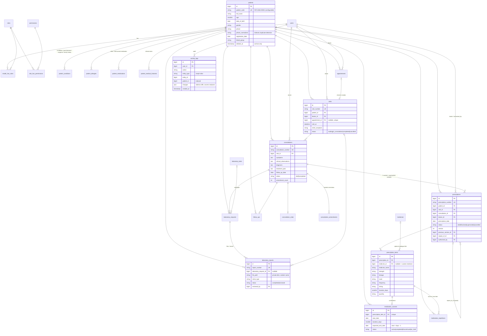

# Database ERD

MySQL 8, InnoDB, utf8mb4. Every foreign key on clinical data is `RESTRICT ON DELETE` — historical
records can never be cascaded away. Users are deactivated (and soft-deleted), never hard-deleted, so
authorship is always preserved. Patients and medical-history entries use soft deletes; finalised
consultations and prescriptions have no delete path at all.

Supporting tables: `clinic_settings` (key/value branding & defaults), `document_sequences` (row-locked
counters for patient/visit/Rx numbers), `prescription_templates`, `notifications`, plus Laravel's
`sessions`, `cache`, `jobs` and `failed_jobs`.
